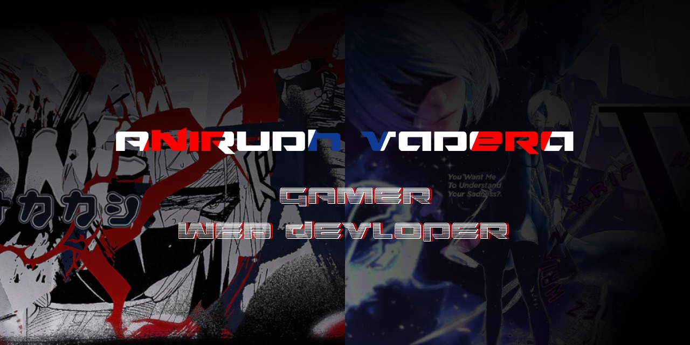

# Anirudh Vadera

**Software Engineer III, Finance Technology | Distributed systems, data platforms, and event-driven financial workflows**

[Portfolio](https://anirudh-vadera.github.io/portfolio/) | [LinkedIn](https://www.linkedin.com/in/anirudh-vadera-8836ba237/) | [LeetCode](https://leetcode.com/u/anirudh00711/) | [Email](mailto:anirudhvadera@gmail.com)

I build production systems where correctness, scale, and operational clarity matter. My current work sits at the intersection of finance technology, distributed backend systems, event streaming, cloud data platforms, and reconciliation workflows at Walmart Global Tech.

    

## Connect With Me

&nbsp;&nbsp;

&nbsp;&nbsp;

&nbsp;&nbsp;

&nbsp;&nbsp;

## Core Stack

- **Languages:** Scala, Java, Python, SQL
- **Big Data and Streaming:** Apache Spark, Spark Streaming, PySpark, Kafka, Pub/Sub, Airflow, ETL Pipelines, Data Modeling
- **Cloud and Infrastructure:** Google Cloud Platform, BigQuery, Cloud Storage, Storage Transfer Service, AutoClass, Docker, Kubernetes, ArgoCD, Jenkins
- **Backend and Systems:** Microservices, Distributed Systems, Event-Driven Architecture, REST APIs, PostgreSQL, MySQL, Flyway
- **Testing and Observability:** ScalaTest, Mockito, Integration and Regression Testing, Grafana, Splunk
- **AI and Knowledge Systems:** LLMs, RAG, Vector Databases, Knowledge Graphs, ChromaDB, NetworkX
- **Scala Ecosystem:** ZIO, Akka, Apache Camel

## Selected Work

| Project / Initiative | What changed |
| --- | --- |
| **LATAM Ledger Expansion** | Expanded Walmart's financial ledger to **6 LATAM countries** and **200+ sources** with per-country isolation (Kafka, GCS, PostgreSQL), posting **10M transactions to SAP in 7 days**. |
| **Balanced SAP Document Splitting** | Split journals into balanced SAP documents under line-item and local-currency limits with exchange-rate conversion: **zero rejections across 100,000 documents**. |
| **Streaming Acknowledgements** | Re-architected the SAP acknowledgement flow from **hourly batch to sub-second** Kafka and Spark Streaming. |
| **Cloud Storage Archival Framework** | Reusable Python service on GCP Storage Transfer Service and AutoClass that archived **104 TB** and saves **$45,000 per year**. |
| **Audit Event Listener** | Scala/ZIO listener with Pub/Sub backpressure, idempotent dedup, and stuck-event recovery, cutting latency by **2-3 s/event**. |
| **PySpark-to-PostgreSQL Upsert** | Cut runtime from **3 hours to 13 minutes** with COPY into unlogged staging tables. |
| **Regression Testing Library** | Generic library covering 50+ business rules across **128+ repositories**, halving production failures. |
| **CodeSage AI** | LLM pipeline over **53,000 documents** (561 repositories, 1,386 incidents, 43 RCAs) with a NetworkX knowledge graph and ChromaDB. Finalist, Walmart FDF AI Hackathon. |
| **TwinAI** | Passive agent that turns IDE, terminal, browser, and LLM activity into a queryable digital twin of an engineer; now used by the entire team. |

## Career Timeline

| Period | Role |
| --- | --- |
| May 2026 - Present | Software Engineer III, Walmart Global Tech - Finance Technology |
| Jul 2024 - Apr 2026 | Software Engineer II, Walmart Global Tech - Finance Technology |
| May 2023 - Jul 2023; Jan 2024 - Jun 2024 | Software Engineering Intern, Walmart Global Tech - Finance Technology |

## Interview Hooks

Ask me about:

- Designing reconciliation systems where missing one line item is a business problem, not just a technical bug.
- Turning a multi-hour PySpark/PostgreSQL job into a minutes-level workflow.
- Cost-aware cloud data movement in GCS and BigQuery.
- Building event-driven source-to-ledger-to-SAP pipelines.
- How I would design an internal knowledge twin for engineering teams without ignoring privacy boundaries.

## Where To Look Next

- Portfolio for the polished walkthrough: [anirudh-vadera.github.io/portfolio](https://anirudh-vadera.github.io/portfolio/)
- GitHub repositories for public project code: [github.com/ANIRUDH-VADERA](https://github.com/ANIRUDH-VADERA)
- LeetCode for algorithmic consistency and contest history: [leetcode.com/u/anirudh00711](https://leetcode.com/u/anirudh00711/)

## GitHub Profile

    

## GitHub Stats

    
    

    
    

## Productivity Stats

    

    

## Contribution Snake

    

---

I like problems that require equal parts engineering depth, business context, and operational patience. If the system has money movement, scale, reconciliation, and a pager attached to it, I am probably interested.
