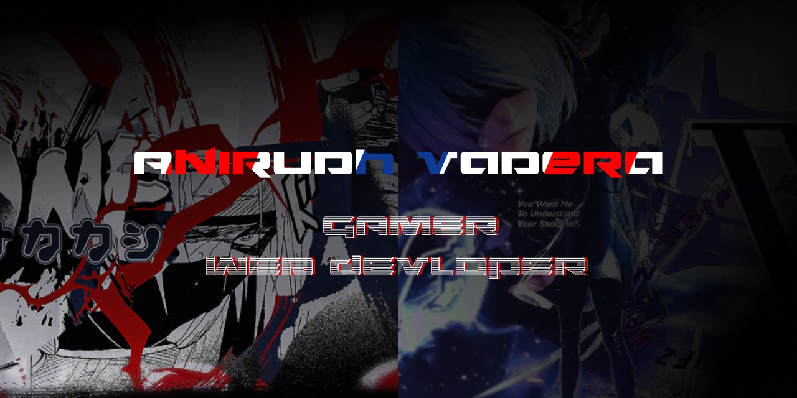

# Anirudh Vadera

**Software Engineer III @ Walmart Global Tech | Distributed systems, event streaming, and financial data platforms**

[Portfolio](https://anirudh-vadera.github.io/portfolio/) · [LinkedIn](https://www.linkedin.com/in/anirudh-vadera-8836ba237/) · [LeetCode](https://leetcode.com/u/anirudh00711/) · [Email](mailto:anirudhvadera@gmail.com)

I build production systems where correctness, scale, and operational clarity matter. I own services in Walmart's financial ledger, which journals **85% of Walmart's revenue (~$600B a year, peak ~$2B a day)** across **100M+ transactions/day**, working across Kafka, Spark, GCP, and PostgreSQL in Scala, Java, and Python.

    

## Featured Projects

| Project | What it is |
| --- | --- |
| [**CodeSage AI**](https://github.com/ANIRUDH-VADERA/CodeSage-AI) | Hybrid retrieval (BM25 + vectors + entity graph) over code, runbooks, and incidents, with cited answers, auto-generated wiki pages, and a PR guardrail that flags changes resembling past outages. Inspired by Karpathy's idea of an LLM-maintained wiki. |
| [**TwinAI**](https://github.com/ANIRUDH-VADERA/TwinAI) | A passive agent that turns an engineer's IDE, terminal, and review activity into a queryable "digital twin" with confidence-scored answers and expert routing. |
| [**GCS Archival Framework**](https://github.com/ANIRUDH-VADERA/gcs-archival-framework) | Age-based archival of cold GCS data with Storage Transfer Service: batch planning, cost estimates, an idempotent job ledger, and verification. |
| [**Portfolio**](https://github.com/ANIRUDH-VADERA/portfolio) | Interactive portfolio built with React and Three.js. |

## Selected Work at Walmart

| Initiative | Impact |
| --- | --- |
| **LATAM Ledger Expansion** | Expanded the ledger to **6 LATAM countries** (10% of global business) and **200+ sources** with per-country fault isolation across Kafka, GCS, and PostgreSQL; posted **100M transactions to SAP in 7 days**. |
| **Balanced SAP Document Splitting** | Algorithm that splits multi-currency journals into balanced documents (max 995 line items, each under SAP's 99.99B currency limit) with exchange-rate conversion: **zero rejections across 100K documents**. |
| **Streaming Acknowledgements** | Re-architected hourly batch acknowledgements into a Kafka and Spark Streaming pipeline for **100M transactions/day**, delivering acks in **under a second instead of up to 60 minutes**. |
| **Audit Event Listener** | Scala/ZIO service handling **100K events/s** with Pub/Sub backpressure, idempotent dedup, and stuck-event recovery; latency from **~5s to 100ms**, and a 100K-message backlog cleared 3 hours faster. |
| **Ending Inventory Reconciliation (Java)** | Event-driven, line-item-level pipeline that cut processing from **1–2 hours to 3–5 minutes**, delivered under a tight deadline with SAP, source-system, and controllership teams. |
| **PySpark-to-PostgreSQL Upsert** | **3 hours to 13 minutes** by bulk-loading with COPY into unlogged staging tables to skip WAL overhead. |
| **Lead Company Code Derivation** | 7 derivation strategies for batch tax assignment, improving tax accuracy by **20%**. |
| **Cloud Storage Archival** | Archived **104 TB** of 13+ month-old ledger data, saving **$45,000 per year** in storage and BigQuery costs. |
| **Regression Testing Library** | Covered 50+ business rules across **128+ repositories** in CI, cutting production failures by **50%** and release cycles by 30%. |
| **Real-Time Reconciliation and Alerting** | Akka-based reconciliation, error-log alerting, and automated incident creation, cutting time to detect by **90%**. |

## Core Stack

- **Languages:** Scala, Java, Python, SQL
- **Databases:** PostgreSQL (HikariCP, Flyway), MySQL, BigQuery
- **Backend and Distributed Systems:** Microservices, REST APIs, Event-Driven Architecture, Akka, ZIO, Apache Camel
- **Big Data and Streaming:** Kafka, Spark, Spark Streaming, Spark SQL, PySpark, Pub/Sub, Airflow, Dataproc
- **Cloud and DevOps:** Google Cloud Platform, Cloud Run Functions, Dataflow, Docker, Kubernetes, Helm, Terraform
- **CI/CD and Observability:** Jenkins, ArgoCD, Git, Prometheus, Grafana, OpenTelemetry, Splunk, Superset, Tableau
- **AI:** LLMs, NLP, RAG, ChromaDB, FAISS, AI Agents, MCP
- **Testing:** ScalaTest, Mockito, integration and load testing

## Ask Me About

- Designing reconciliation systems where one missing line item is a business problem, not just a bug.
- Turning a multi-hour PySpark and PostgreSQL job into a minutes-level one.
- Cost-aware data movement in GCS and BigQuery.
- Building event-driven source-to-ledger-to-SAP pipelines.
- Designing a knowledge twin for engineering teams without ignoring privacy boundaries.

## Highlights

- **LeetCode Knight** (top 5% globally): peak rating 1981, 1,100+ problems, [rank 668 in Weekly Contest 341](https://leetcode.com/contest/weekly-contest-341/ranking/27/?region=global_v2)
- **Making a Difference Award**, Walmart Global Tech, FY2025
- Finalist, Walmart FDF AI Hackathon and DevJams'21 (Google Developer Student Clubs VIT)
- B.Tech in Computer Science, Vellore Institute of Technology (CGPA 9.53/10)

## GitHub Stats

    

    
    

    
    

    

    

